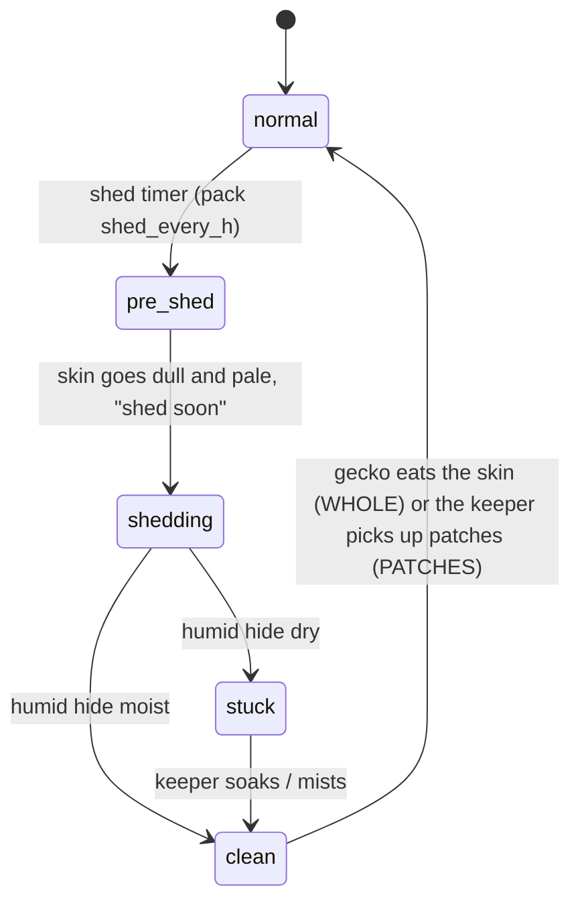
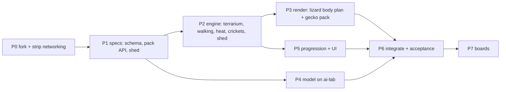

# pocket-terrarium — plan

A proof-of-concept port of [pocket-tank](../pocket-tank) v0.4.0 to a lizard
terrarium. It keeps pocket-tank's three layers (reflex in `common/tank.c`, LLM
advisor in `common/llm/`, progression in `common/progression.c`) and the same
four Waveshare boards.

**Built around species packs.** The engine and the model know nothing about any
one species. Everything species-specific lives in a pack. The first pack is the
leopard gecko; bearded dragon, monitor and chameleon follow as more packs.

Status: P0 done (2026-11-04). Next: P1 specs.

---

## 0. Decisions

| # | Decision | Chosen |
|---|---|---|
| D1 | First pack | **Leopard gecko**. Ground-walking is shared with bearded dragon and monitor, and the crab's walk (`tank.c` `crab_tick` ~1752) is the template. Climbing comes with the chameleon pack. |
| D2 | Day/night | **Same for every species for now**: active by day, rests at night, like the fish. The model sees an activity *phase*, not the clock (see §2), so a pack can later move the phase (a nocturnal gecko) without retraining. |
| D3 | Species packs | **Yes, in the core design** (§2). The engine has no species code paths; a pack is data plus a body-plan renderer. |
| D4 | Scope | **POC.** Networking off: OTA, tank-link, passports, gifts, the visitors collection. Anything else that conflicts with the port also gets disabled rather than ported. |
| D5 | Repo | `git clone` pocket-tank with history and keep an `upstream` remote so engine/board fixes can merge in. |
| D6 | Brain | Retrain from scratch on a species-agnostic lizard schema (ai-lab). A fish→lizard goal map is the temporary brain until the model lands, then it is deleted. |
| D7 | Save | New format (new magic, NVS namespace `terr`), append-only from day one (`SAVE_LAYOUT_LOCK` pattern, `progression.c` ~308). |
| D8 | Shed | **In v1** as a core upkeep loop (§3). |
| D9 | License | PolyForm Noncommercial, inherited. Keep the required `NOTICE` lines. Commercial use needs the author's permission. |

---

## 1. Risks

- **R1 — OTA would overwrite the port.** `firmware/main/net_port_esp.c:60` hardcodes
  the upstream release manifest and the device trusts upstream's signing key; a
  POC build would "update" back into a fish tank. **Compile OTA out** (D4); also
  remove the `IMPROV_URL` in `firmware/main/director.c:1121`.
- **R2 — Tank-link mixing.** Tank-link runs over ESP-NOW (`firmware/main/link_port_espnow.c`). **Compiled out** (D4).
- **R3 — The teacher prompt decides behaviour.** Run `model/prompt_check.py` before
  every long generation run (`docs/pipeline.md`).
- **R4 — C and Python encoders must match byte for byte.** `advisor_core_encode()` (`common/llm/advisor_core.c` ~70) vs `encode()`
  (`model/gen_traces.py:450`). Add a test that runs both on the same states.
- **R5 — Frame budget.** 25–30 fps on the 1.8; the urchin's spines alone cost 1.8 ms/frame.
  Lizard bodies use a pose cache like the crab's (`cr_build`, `render.c` ~3678).
- **R6 — A species-agnostic model can blur species.** If the drives are not
  normalised per pack, a bearded dragon and a gecko answer the same way.
  §2 normalises at the reflex layer; checked in P6.

---

## 2. Species packs

### What the engine owns (shared by every lizard)
Walking, turning, the heat field, prey AI, hides, the shed cycle, touch,
progression and the model. None of it names a species.

### What a pack owns
```c
typedef struct {
    const char *name;                 /* "leopard gecko" */
    /* activity: which clock hours map to which phase (D2: all packs use DAY for now) */
    uint8_t     schedule;             /* SCHED_DAY today; SCHED_DUSK / SCHED_NIGHT later */
    /* heat: the pack's comfort band in world temperature; the engine maps it to heat 0..9 */
    float       heat_lo, heat_hi;
    /* rates */
    float       hunger_per_h, energy_per_h, shed_every_h, shed_window_h;
    float       stage_h[4];           /* hatch -> juv -> adult -> elder */
    uint8_t     pop_cap;              /* geckos 3 */
    uint8_t     shed_style;           /* WHOLE (gecko eats it) / PATCHES (dragon) */
    uint8_t     diet;                 /* bitmask: crickets, mealworms, greens ... */
    /* body plan for the renderer */
    uint8_t     plan;                 /* PLAN_LIZARD today (one renderer, parameterised) */
    lizard_geom_t geom;               /* length, head shape, limb length, tail fat, eye size, eyelids */
    const morph_t *morphs; uint8_t n_morphs;   /* gecko: normal, tangerine, albino, blizzard, mack snow */
    const pattern_t *juv_pattern, *adult_pattern;   /* gecko: banded -> spotted */
    /* goal tuning: how the reflex performs each goal (speeds, strike range, dig rate) */
    goal_style_t goals[GOAL_COUNT];
} species_t;
```
Packs are compiled in (`common/species/gecko.c`), selected per terrarium at
setup and stored in the save. There is no runtime loading, so no file format to
freeze. The shape above is a draft, to be settled in P1.

### Why the model stays species-agnostic
The reflex layer normalises everything to the pack before encoding:
- `heat` 0–9 is **relative to the pack's comfort band** (5–6 = comfortable for *this* species).
- `phase active|wind|rest` replaces `time day|night`; the pack's `schedule` maps the clock to it.
- Hunger, energy and stress use the pack's rates, so the model only sees 0–9.

One model then serves every lizard pack, and a new pack needs **no retrain**
as long as it fits the seven goals. Adding a goal (e.g. chameleon `climb`) is a schema change.

### Schema draft (≈ 46 tokens + 3 out; seq_len 64 fits)
```
zone 2 hunger 7 energy 5 stress 2 curiosity 8 heat 3 bold 4 social 2
stage adult trust 6 bored 3 shed no prey near 12 mate mid 3 warm far 10
hide near 7 wall clear last explore phase active  ->  bask urgency 7
```
- New fields: `heat`, `shed no|soon|yes`, `phase`; sightings `prey`, `mate` (nearest other lizard), `warm`, `hide`.
- Stages `hatch|juv|adult|elder`. `social` = tolerance of others (low = territorial).
- Vocabulary ≈ 60 words. The model's size is read from its header (`q4_config_t`, `common/llm/q4_model.h:18`), so no C changes for size.

### Goals (7)
| Goal | Replaces | Reflex performs (pack tunes it) |
|---|---|---|
| `hunt` | seek_food | stalk, tail-tip wiggle, freeze, lunge at a moving cricket; can miss |
| `bask` | visit_bubbles | go to the warm spot, flatten, heat rises |
| `hide` | inspect_reef | enter the hide that suits the need: cool if hot, **humid if shedding** |
| `explore` | explore | slow walk with tongue flicks into a new zone |
| `investigate` | follow_friend | tongue-flick decor or another lizard; standoff if `social` is low |
| `dig` | dart_play | scrabble at the substrate (playful/bored outlet) |
| `rest` | rest | lie still, eyes closing |

---

## 3. Shed: the new upkeep loop

The cycle gives the keeper a reason to check in, alongside wiping the glass and trimming plants.


- **Humid hide moisture** dries over hours. The keeper keeps it damp with a
  **mister** tool, added next to the existing sponge and scissors (tool UI in `render.c`,
  "DONE" chip, two-minute auto-return).
- **Pre-shed** is visible: the skin dulls (desaturated palette), the lizard eats
  less and `shed soon` steers the model toward `hide`.
- **Stuck shed** shows on toes and the tail tip and raises `stress` until it is
  fixed: mist the hide, or hold on the lizard for a "soak". It costs a little trust
  if neglected for long.
- **Milestones:** first clean shed, first stuck shed fixed, a run of clean sheds.
- Shed gates growth: a stage change happens at a shed (as real lizards grow).
- Pack parameters: `shed_every_h`, `shed_window_h`, `shed_style`.

---

## 4. World and upkeep

| Fish tank | Terrarium |
|---|---|
| water gradient, bubbles | back wall, warm/cool gradient, lamp glow, heat shimmer |
| sand floor | substrate the lizard digs and leaves tracks in |
| pellets sink | **crickets hop and flee** (new prey AI); mealworms stay in a dish |
| algae film, sponge | glass smudges, sponge (reuse `tank_glass_*`) |
| seagrass, scissors | potted plants, scissors (reuse `draw_veg` frond chain) |
| — | **mister**: humid hide moisture (§3) |
| — | **latrine corner**: lizards pick a toilet corner; spot-clean it (tap) |
| fry born in grass | POC: hatchlings arrive by meeting gates (like fry); eggs + incubation later |
| shop: snail, crab, shrimp … | shop: cork bark, hides, plants, rocks, isopods (clean-up crew) |

---

## 5. Phases



### P0 — Fork and strip (done 2026-11-04)
- [x] pocket-tank v0.4.0 merged into this repo with its history; `upstream` = mediacutlet/pocket-tank
- [x] Baseline: sim `make check` 58/58 on Linux; firmware builds on ESP-IDF **5.5.2** (upstream CI pins 5.4.1)
      after one fix: the ESP-NOW send callback's 5.5 signature (`LP_SENT_TO`, `link_port_espnow.h`)
- [x] **`PT_NET 0`** (`common/version.h`): no update mode, Improv provisioning, internet clock or saved network
      (`main.c`); director `wifi`/`ota`/`link` refused and Improv RPCs answered "unknown" (`director.c`); UPDATES and
      LINK not drawn on settings and their boxes dead (`render.c`); no VISITORS square on the keeper page
      (`MSF_SHOWN`). Link/gift/passport/collection code stays compiled (upstream merges) but nothing reaches it.
- [x] Identity: NVS namespace `terr` (save + every firmware key beside it), shelf journal `terrframe`, shelf slot
      magic `TRS1`, book magic `TRV1`, board marker `TRBOARD`, sim state in `~/.cache/pocket-terrarium`, tool build
      dirs likewise. A board that ran pocket-tank keeps its tank save in NVS `tank` untouched.
- Kept on purpose: `SAVE_MAGIC` "PTK2" (the 17 save fixtures keep testing the layout until P5's new format),
  `PT_BOARD` ids (they name hardware), `project(pocket_tank)` (tools and CI name `pocket_tank.bin`),
  `PT_MODEL_TAG` "v3m" (it describes the shipped fish model; becomes `lizard_v1` in P6 with the new model).
- Risk: the `storage` partition is shared. Our shelf never reads pocket-tank's slots or books, but MY TANKS can
  write over them. Flashing this onto a board that holds parked pocket-tank tanks can lose those (not the live one).
- Not done: the GitHub workflows still target upstream's release/installer flow; they need rework before any tag.
- Verified: sim `make check` 58/58 on all four layouts (1.8, round, watch, square); settings page shows CLOSE only
  and the keeper page four squares (page shots); firmware builds; the hardware image boots in QEMU to `app_main`
  with the terrarium banner and stops at the absent panel's I2C, as any hardware image there does.
  Upstream rot found, not ours: the QEMU overlay (`sdkconfig.qemu`) no longer links (`touch_port_stub.c` lacks
  the 0.4 touch-lock functions), and a signed image aborts in QEMU ("no signatures found").
- This machine: no `libsdl2-dev`; the sim builds against headers unpacked to `~/.cache/pocket-terrarium/sdl2`
  (`make SDL_CFLAGS=... SDL_LIBS=-l:libSDL2-2.0.so.0`). `sudo apt install libsdl2-dev` makes plain `make` work.

### P1 — Specs (docs, no code)
- [ ] `model/schema-lizard.md`: fields, ranges, vocabulary, goals; frozen before generating traces
- [ ] `docs/species-pack.md`: the `species_t` contract, normalisation rules (§2)
- [ ] `docs/shed.md`: timers, moisture decay, stuck-shed rules, tool
- [ ] Model acceptance targets written before training (P6)

### P2 — Engine (`common/tank.c`/`tank.h`): largest piece
- [ ] `species_t` + the gecko pack; save stores the pack id
- [ ] Geometry: floor and terraces per board (the round pendant needs a floor arc)
- [ ] Remove swimming: depth picking (`depth_pick` ~3490), buoyancy, schooling
- [ ] Walking: trot gait, turn on the spot, stop-and-go pacing (from `crab_tick` ~1752)
- [ ] Heat field + `heat` normalised to the pack band; lamp on the light schedule
- [ ] Hides (warm/cool/humid): entering, hidden, peeking
- [ ] Crickets: spawn on feed tap, hop/flee AI, hide in decor; strike hit/miss
- [ ] Shed state machine + humid-hide moisture + the mister tool (§3)
- [ ] The 7 goals → motion (`target_for_goal` ~3200–3415), tuned per pack
- [ ] Touch: hold = hand in the terrarium (trust), rap = startle, tap = crickets
- [ ] Temporary fish→lizard goal map (deleted in P6)

### P3 — Render (`common/render.c`)
- [ ] Terrarium scene in the scene cache: wall, gradient, substrate, lamp glow
- [ ] `draw_lizard(plan, geom, morph, pose)`: spine-chain body (from `draw_veg` ~1491), 4 legs with gait,
      tail thickness = fat reserve, eyes with eyelid blink, tongue flick
- [ ] Pose cache like the crab's; profile on the 1.8 (`render_prof_us`)
- [ ] Shed visuals: dull skin, peeling patches, stuck bits on toes and tail tip
- [ ] Gecko pack art: morphs (normal, tangerine, albino, blizzard, mack snow), banded hatchling → spotted adult
- [ ] Icons (`assets/icons` via `tools/gen_icons.py`): redraw the fish-specific milestones, shop items and tools; add the mister

### P4 — Model (ai-lab)

Lab ([local-ai-lab](https://github.com/dopamine911/local-ai-lab)): llama-swap on llama.cpp/Vulkan,
one OpenAI-compatible API on zaphod over Tailscale (`marvin/*` forwarded). No Ollama, no ROCm.

**Teacher candidates** (pick by a measured pilot, not by guess):

| Model | Machine | For | Against |
|---|---|---|---|
| `chat`: Gemma 4 31B | zaphod card 2 | same family as the shipped teacher (gemma4:26b), so the fish prompt's style should carry over | shares card 2 with `ornith`/speech/ComfyUI; dense, slower |
| `ornith`: 35B-A3B MoE | zaphod card 2 | fastest (~90 tok/s writing) | reasoning model: thinking must be off; untested as a labeller |
| `marvin/big`: Qwen3.8-Flash-Next | marvin | strongest; **runs overnight on marvin without taking zaphod's cards from daily use** | 318 tok/s reading: slow if the system prompt is re-read every call |

**Recommended: `chat` as the teacher, `marvin/big` as the auditor.** The pilot confirms or overturns this.
`marvin/big` re-labels a ~1k sample of `chat`'s traces; disagreement concentrated on one goal points to a prompt bug.

**Measured on `chat` (2026-11-04, the fish v4 prompt and states from `gen_traces.py`):**
- The prompt prefix **is** reused per slot: 740 of ~808 prompt tokens cached, ~69 read per call.
- **Gemma 4 thinks by default here.** Without `chat_template_kwargs: {enable_thinking: false}` it spends all
  48 tokens thinking and returns empty content. With it: 65/65 valid JSON goals.
- Per call ~1.9 s: ~1.0 s reading 69 tokens (70 tok/s) + ~0.9 s writing 23 tokens (25 tok/s).
- **~33 decisions/min, and 3 parallel workers give the same 33/min**: the server serves one request at a time.
  45k pairs ≈ 23 h (three nights); 30k ≈ 15 h.
- **Teacher: `chat-teacher`** (llama-swap, zaphod card 2; lab-tuned 2026-11-04): same Gemma file, 4 slots × 4K,
  `--swa-full`, q8_0 KV, `--reasoning off`, no vision, `ttl: 900`, hidden from Open WebUI. The first 8-slot f16
  version spilled 0.9 GB out of card 2's memory and did not scale (27.7/min at 8 workers); now 28.4 GB, no spill.
- **Measured with the real fish states, from this workstation over Tailscale:**
  1 worker 63.1/min (0.96 s/call), **4 workers 126.7/min** (1.83 s/call); JSON 200/200 valid; prompt reuse
  746 of ~808 tokens median; largest request 840 tokens. No per-request thinking setting needed.
  45k pairs ≈ 6 h: one night. Run with **4 workers** (4 slots; more only queue).

- [ ] `gen_traces.py`: add an OpenAI-compatible client next to `ask_ollama` (`gen_traces.py:483`):
      `/v1/chat/completions`, `response_format: json_schema` from `output_schema()`,
      `temperature 0.7`, `max_tokens 48`. Still send `chat_template_kwargs: {enable_thinking: false}`: harmless on
      `chat-teacher` (server has `--reasoning off`) and required for the `marvin/big` audit. Key read from an env var,
      never a CLI arg or the repo. No `tools` in the request (the lab's known Qwen bug is tools + JSON format together).
      Prompt + answer must stay under the 4K slot.
- [ ] `gen_traces.py --schema lizard`: a Python `Lizard`/`Terrarium` sim (replaces `Fish`/`Tank`, lines 163/198),
      new `encode()`, new species-agnostic `SYSTEM_PROMPT_LIZARD`
- [ ] Sample states across the full ranges of the normalised drives, so future packs land inside the training distribution
- [ ] **Pilot**: ~40 hand-written edge states (starving, cold, overheated, shedding, rest phase, bored)
      with expected goals. Run each candidate teacher on them; record rules-agreement, JSON
      failure rate and decisions/min. Log to the lab's MLflow like its other benchmarks. Pick the teacher.
- [ ] `prompt_check.py` pass (R3)
- [ ] Traces, overnight: target ~40–50k pairs (no old traces carry over). Workers =
      parallel slots on the teacher's server; each worker is sequential because decisions feed back into its sim
      (`gen_traces.py:590`)
- [ ] `fold_traces.py` → `train_tokenizer.py` → `train.py` (dim 384, 8 layers, seq 64) → `export_q4.py`
- [ ] Training hardware: **CPU PyTorch** is enough. 6 × 14.3M params × 64×64 tokens × 5,000 iters ≈ 1.8 PFLOP,
      roughly 1–3 h on marvin's 16 Zen 5 cores or zaphod's 3900X [INFERENCE: time 100 iters first].
      GPU training would need a ROCm PyTorch the lab doesn't have (lab issue #16 is about llama.cpp only)
      and would compete with the served models.
- [ ] C/Python encoder parity test (R4)

### P5 — Progression and UI
- [ ] Stages advance at sheds; trust via handling
- [ ] Milestones: first cricket caught, first clean shed, first bask, first hand approach, first dig
- [ ] Arrivals: hatchling gates (trust, meals, clean sheds), pop cap from the pack
- [ ] Shop items and prices; currency renamed
- [ ] Setup: choose a species pack (one for now) and a morph; strings "fish/tank" → "lizard/terrarium"

### P6 — Integrate and accept
- [ ] Ship the model + tokenizer, delete the temporary goal map
- [ ] Acceptance (modelled on `docs/retrain-v4.md`): teacher agreement ≥ 72%; hunger 9 → `hunt` ≥ 0.86;
      heat 0–2 → `bask` ≥ 0.8; heat 9 → `hide` ≥ 0.8; `shed yes` → `hide` ≥ 0.6;
      `phase rest` → `rest|hide` ≥ 0.85; bored 8–9 → not `last` ≥ 0.6; bold/social slopes not flat
- [ ] Sim census: zones visited, time inside the heat band, crickets caught per hour, sheds clean vs stuck

### P7 — Boards
- [ ] Sim screenshots on all 4 boards (`tools/shot.py`), QEMU boot, flash a device (`tools/flash.sh`)
- [ ] Frame time on the 1.8

---

## 6. Size (rough)

| Area | New/changed lines | Confidence |
|---|---|---|
| Engine incl. shed (P2) | 2,300–3,300 | 0.6 |
| Render (P3) | 1,300–1,900 + icons | 0.6 |
| Model pipeline (P4) | 1,000–1,500 | 0.7 |
| Progression/UI (P5) | 700–1,300 (networking stripped) | 0.5 |
| Fork/strip (P0) | 100–300 | 0.8 |
| **Total** | **~5,500–8,000** | **0.5** |

---

## 7. Later packs

| Pack | Fits the 7 goals? | Needs from the engine |
|---|---|---|
| Bearded dragon | yes | patchy shed (`shed_style`), greens in the diet, arm-wave/head-bob displays (render only) |
| Monitor | yes | larger body geometry, faster pursuit tuning, burrow digging |
| Chameleon | **no**: needs `climb` | branches + an arboreal motion layer, colour by mood (stress/heat → palette), projectile tongue. Schema change + retrain |
| Crested gecko | **no**: needs `climb` | glass clinging; share the chameleon's arboreal layer |

Nocturnal or crepuscular packs only change `schedule` (§2, D2): no retrain.
