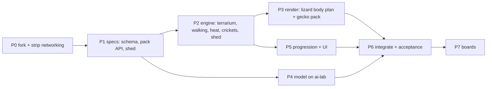

# pocket-terrarium — plan

A proof-of-concept port of [pocket-tank](../pocket-tank) v0.4.0 to a lizard
terrarium. It keeps pocket-tank's three layers (reflex in `common/tank.c`, LLM
advisor in `common/llm/`, progression in `common/progression.c`) and the same
four Waveshare boards.

**Built around species packs.** The engine and the model know nothing about any
one species. Everything species-specific lives in a pack. The first pack is the
leopard gecko; bearded dragon, monitor and chameleon follow as more packs.

Status: P1 specs drafted (2026-11-04): `model/schema-lizard.md`, `docs/species-pack.md`, `docs/shed.md`. Next: P2 engine and P4 model in parallel.

---

## 0. Decisions

| # | Decision | Chosen |
|---|---|---|
| D1 | First pack | **Leopard gecko**. Ground-walking is shared with bearded dragon and monitor, and the crab's walk (`tank.c` `crab_tick` ~1752) is the template. Climbing comes with the chameleon pack. |
| D2 | Day/night | **Same for every species for now**: active by day, rests at night, like the fish. The model sees an activity *phase*, not the clock (see §2), so a pack can later move the phase (a nocturnal gecko) without retraining. |
| D3 | Species packs | **Yes, in the core design** (§2). The engine has no species code paths; a pack is data plus a body-plan renderer. |
| D4 | Scope | **POC.** Networking off: OTA, tank-link, passports, gifts, the visitors collection. Anything else that conflicts with the port also gets disabled rather than ported. |
| D5 | Repo | `git clone` pocket-tank with history and keep an `upstream` remote so engine/board fixes can merge in. |
| D6 | Brain | Retrain from scratch on a species-agnostic lizard schema (ai-lab). A fish→lizard goal map was the temporary brain until the model landed; deleted at P6 (2026-11-05). |
| D7 | Save | New format (new magic, NVS namespace `terr`), append-only from day one (`SAVE_LAYOUT_LOCK` pattern, `progression.c` ~308). |
| D8 | Shed | **In v1** as a core upkeep loop (§3). |
| D9 | License | PolyForm Noncommercial, inherited. Keep the required `NOTICE` lines. Commercial use needs the author's permission. |
| D10 | Habitats | The enclosure is a pack too (`docs/habitat-pack.md`): a tank holds a habitat id and a species id, compatible by the species' list. v1: desert + leopard gecko. |
| D11 | Worlds | **One reusable core, one bin per world**: an aquarium bin (fish) or a terrarium bin (lizards). Each bin carries one model (8 MB partition, 7.56 MB model), its schema, its packs and its locomotion. Swimming code is kept, never deleted; packs carry `world`. |

---

## 1. Risks

- **R1 — OTA would overwrite the port.** `firmware/main/net_port_esp.c:60` hardcodes
  the upstream release manifest and the device trusts upstream's signing key; a
  POC build would "update" back into a fish tank. **Compile OTA out** (D4); also
  remove the `IMPROV_URL` in `firmware/main/director.c:1121`.
- **R2 — Tank-link mixing.** Tank-link runs over ESP-NOW (`firmware/main/link_port_espnow.c`). **Compiled out** (D4).
- **R3 — The teacher prompt decides behaviour.** Run `model/prompt_check.py` before
  every long generation run (`docs/pipeline.md`).
- **R4 — C and Python encoders must match byte for byte.** `advisor_core_encode()` (`common/llm/advisor_core.c` ~70) vs `encode()`
  (`model/gen_traces.py:450`). Add a test that runs both on the same states.
- **R5 — Frame budget.** 25–30 fps on the 1.8; the urchin's spines alone cost 1.8 ms/frame.
  Lizard bodies use a pose cache like the crab's (`cr_build`, `render.c` ~3678).
- **R6 — A species-agnostic model can blur species.** If the drives are not
  normalised per pack, a bearded dragon and a gecko answer the same way.
  §2 normalises at the reflex layer; checked in P6.

---

## 2. Species packs

### What the engine owns (shared by every lizard)
Walking, turning, the heat field, prey AI, hides, the shed cycle, touch,
progression and the model. None of it names a species.

### What a pack owns
Spec: `docs/species-pack.md`. A compiled-in `const species_t` per species
(`common/species/<name>.c`), its id stored in the save: activity schedule, the
heat band (`t_cold < t_lo < t_hi < t_hot` °C), drive rates, stage and shed
timings, population cap, diet, body geometry, morphs and patterns per stage,
and how the reflex performs each goal. Gecko v1 values are in the spec.

### Why the model stays species-agnostic
The reflex layer normalises everything to the pack before encoding:
- `heat` 0–9 is **relative to the pack's comfort band** (5–6 = comfortable for *this* species).
- `phase active|settle|sleep` replaces `time day|night`; the pack's `schedule` maps the clock to it.
- Hunger, energy and stress use the pack's rates, so the model only sees 0–9.

One model then serves every lizard pack, and a new pack needs **no retrain**
as long as it fits the seven goals. Adding a goal (e.g. chameleon `climb`) is a schema change.

### Schema (spec: `model/schema-lizard.md`; 43 state words worst case, 48 of 64 positions with the answer)
```
zone 2 hunger 7 energy 5 stress 2 curiosity 8 heat 3 bold 4 social 2
stage adult trust 6 bored 3 shed no prey near 12 other mid 3 warm far 10
shelter near 7 wall clear last explore phase active  ->  bask urgency 7
```
- New fields: `heat`, `shed no|soon|yes`, `phase`; sightings `prey`, `other` (nearest other lizard), `warm`, `shelter`.
  Sighting and phase words never double as goals (`shelter`/`hide`, `sleep`/`rest`).
- Stages `hatch|juv|adult|elder`. `social` = tolerance of others (low = territorial).
- Vocabulary 59 ids. The model's size is read from its header (`q4_config_t`, `common/llm/q4_model.h:18`), so no C changes for size.

### Goals (7)
| Goal | Replaces | Reflex performs (pack tunes it) |
|---|---|---|
| `hunt` | seek_food | stalk, tail-tip wiggle, freeze, lunge at a moving cricket; can miss |
| `bask` | visit_bubbles | go to the warm spot, flatten, heat rises |
| `hide` | inspect_reef | enter the hide that suits the need: cool if hot, **humid if shedding** |
| `explore` | explore | slow walk with tongue flicks into a new zone |
| `investigate` | follow_friend | tongue-flick decor or another lizard; standoff if `social` is low |
| `dig` | dart_play | scrabble at the substrate (playful/bored outlet) |
| `rest` | rest | lie still, eyes closing |

---

## 3. Shed: the new upkeep loop

Spec: `docs/shed.md`. The cycle normal → soon → shedding → clean or stuck, on
pack timers. The keeper keeps the humid hide damp with a third tool, the
**mister**; a lizard that spends 60 s in a damp humid hide while shedding sheds
clean, otherwise it sticks (stress up to 6, growth held) until a damp stay or a
3-second soak with the mister clears it. **Every stage change is preceded by a shed**:
reaching a stage's age starts a growth shed at once, and the stage changes when it comes off clean.

---

## 4. World and upkeep

| Fish tank | Terrarium |
|---|---|
| water gradient, bubbles | back wall, warm/cool gradient, lamp glow, heat shimmer |
| sand floor | substrate the lizard digs and leaves tracks in |
| pellets sink | **crickets hop and flee** (new prey AI); mealworms stay in a dish |
| algae film, sponge | glass smudges, sponge (reuse `tank_glass_*`) |
| seagrass, scissors | potted plants, scissors (reuse `draw_veg` frond chain) |
| — | **mister**: humid hide moisture (§3) |
| — | **latrine corner**: lizards pick a toilet corner; spot-clean it (tap) |
| fry born in grass | POC: hatchlings arrive by meeting gates (like fry); eggs + incubation later |
| shop: snail, crab, shrimp … | shop: cork bark, hides, plants, rocks, isopods (clean-up crew) |

---

## 5. Phases



### P0 — Fork and strip (done 2026-11-04)
- [x] pocket-tank v0.4.0 merged into this repo with its history; `upstream` = mediacutlet/pocket-tank
- [x] Baseline: sim `make check` 58/58 on Linux; firmware builds on ESP-IDF **5.5.2** (upstream CI pins 5.4.1)
      after one fix: the ESP-NOW send callback's 5.5 signature (`LP_SENT_TO`, `link_port_espnow.h`)
- [x] **`PT_NET 0`** (`common/version.h`): no update mode, Improv provisioning, internet clock or saved network
      (`main.c`); director `wifi`/`ota`/`link` refused and Improv RPCs answered "unknown" (`director.c`); UPDATES and
      LINK not drawn on settings and their boxes dead (`render.c`); no VISITORS square on the keeper page
      (`MSF_SHOWN`). Link/gift/passport/collection code stays compiled (upstream merges) but nothing reaches it.
- [x] Identity: NVS namespace `terr` (save + every firmware key beside it), shelf journal `terrframe`, shelf slot
      magic `TRS1`, book magic `TRV1`, board marker `TRBOARD`, sim state in `~/.cache/pocket-terrarium`, tool build
      dirs likewise. A board that ran pocket-tank keeps its tank save in NVS `tank` untouched.
- Kept on purpose: `SAVE_MAGIC` "PTK2" (the 17 save fixtures keep testing the layout until P5's new format),
  `PT_BOARD` ids (they name hardware), `project(pocket_tank)` (tools and CI name `pocket_tank.bin`),
  `PT_MODEL_TAG` "v3m" (it describes the shipped fish model; becomes `lizard_v1` in P6 with the new model).
- Risk: the `storage` partition is shared. Our shelf never reads pocket-tank's slots or books, but MY TANKS can
  write over them. Flashing this onto a board that holds parked pocket-tank tanks can lose those (not the live one).
- Not done: the GitHub workflows still target upstream's release/installer flow; they need rework before any tag.
- Verified: sim `make check` 58/58 on all four layouts (1.8, round, watch, square); settings page shows CLOSE only
  and the keeper page four squares (page shots); firmware builds; the hardware image boots in QEMU to `app_main`
  with the terrarium banner and stops at the absent panel's I2C, as any hardware image there does.
  Upstream rot found, not ours: the QEMU overlay (`sdkconfig.qemu`) no longer links (`touch_port_stub.c` lacks
  the 0.4 touch-lock functions), and a signed image aborts in QEMU ("no signatures found").
- This machine: no `libsdl2-dev`; the sim builds against headers unpacked to `~/.cache/pocket-terrarium/sdl2`
  (`make SDL_CFLAGS=... SDL_LIBS=-l:libSDL2-2.0.so.0`). `sudo apt install libsdl2-dev` makes plain `make` work.

### P1 — Specs (docs, no code)
- [x] `model/schema-lizard.md`: fields, ranges, vocabulary, goals, the behaviour the teacher must express
- [x] `docs/species-pack.md`: the `species_t` contract, heat/phase normalisation, gecko values, validation
- [x] `docs/shed.md`: the cycle, clean vs stuck, moisture, the mister, milestones, tests
- [x] Model acceptance targets A1–A16 (in `model/schema-lizard.md`), written before training
- Frozen 2026-11-04: the first long trace run started (P4).

### P2 — Engine (`common/tank.c`/`tank.h`): largest piece, in increments that each leave `make check` green

**P2a — lizard state (done 2026-11-04, aa52367)**
- [x] Species packs (`common/species*`, gecko 1, test pack 250) and habitat packs (`common/habitat*`, desert 1),
      both with a `world`; the tank holds a compatible pair; `--selftest-packs`
- [x] Places from the habitat (warm/humid/cool hides, basking spot); heat field, body temperature, `heat` per pack
- [x] Sheds incl. growth sheds gating stages, stuck sheds, moisture, `TOOL_MISTER`; stage ages from the pack
- [x] L1 encoder (`advisor_core_encode_l1`, 420/420 parity lines); save tail 1956..2095; 63/63 on all boards
- Found: the fish's real stage ages are 2 h / 12 h / 96 h (the gecko keeps 20 min / 90 min / 8 h);
  stuck-shed stress is a rising floor (the engine's stress decays ~0.18/s); the spray is not drawn yet

**P2b — the world switch, and lizards move like lizards (done, 16db118)**
- [x] `common/world.h` `PT_WORLD`: sim `make WORLD=aquarium|terrarium`, firmware `POCKET_TANK_WORLD` +
      `sdkconfig.aquarium`; fish pack (2 h / 12 h / 96 h, no sheds) + freshwater habitat keep the aquarium bin as pocket-tank
- [x] One goal enum (fish 8 + lizard 7); the temporary fish-model bridge in `advisor_core.c` (DELETE IN P6)
- [x] THE WALK (`tank.c`): floor band ±5 px, stop-and-go, turns on the spot, hides as a state with peeking, 7 goals → motion
- [x] `check-all`: terrarium 50/50 and aquarium 59/59 on all four boards; both firmware worlds build
- Keeper-free terrarium: heat 4–7 for 99% of lit time, 3/3 growth sheds clean, asleep in a hide or still 96%

**P2b+ — terraces and rocks (done, 0c49a86; user's choice over a deep 3/4 floor)**
- [x] `habitat_t` rocks/ramps/basking surface/air rise; `common/terrain.c` (per-glass layout, rules, Dijkstra routing)
- [x] Desert: low ledge, mid shelf, high rock with the basking spot in the upper half on every board
- [x] Keeper-free: heat 4–7 96–99% of lit time, 3/3 sheds clean, 53–58% of lit time above the floor
- Resolved in P2c/P3b: ramp pitch is drawn; `lizard_half_len` replaces `LZ_HALF_LEN`; crickets replace pellets.
  Open (P2d): climbing from the floor to the basking spot takes ~60 s

**P2c — food and hands (done, d222c80)**
- [x] Crickets land on the ground under the drop, hop, flee, take cover and come out, expire; reachable-prey sight;
      hunt memory; misses by heat/stage/cricket state; one meal per catch. Mealworm dish (save byte 2096). Auto
      crickets only in the active phase. Census: 4.9 crickets per awake lizard-hour (A15 ≥ 4)
- [x] Touch: hold = hand on the ground (trusting lizards come), three taps = startle, tap = card (whole-body hit)
- [x] Money: a keeper meal pays 1 per 300 s awake, a clean shed 5 (`docs/progression.md`, `docs/shed.md`)
- [x] Every selftest runs in its own temp dir (`sim/sim_tmp.c`)
- Open (P2d): most of the 1.8's glass has the high rock or the last ramp under it, so hand-dropped crickets
      rarely land low; misses (46% for hatchlings) and hide times want tuning

**P2d — tuning** against A13–A15 once a lizard model exists

### P3 — Render (`common/render.c`)
**P3a — the art, standalone (done, 16db118)**: `render_lizard.c` (12 poses, 5 morphs, stage patterns, shed looks,
body cache: ~0.4 ms cached / ~2.5–3 ms on a body build on the device, estimated), `render_scene_desert.c`, the mister
icon, `sim --lizard-sheet`.

**P3b — into the tank (done, d222c80)**
- [x] `render_terrarium`: the baked desert and each lizard from its real state; feet-sorted; hide fronts row by row
- [x] Pose fields (walk/dig phase, blink, tongue, fat); `LZ_HALF_LEN` → `lizard_half_len`; ramps end 48 px in
- [x] One scene per light (swap) + per-tick bake slices: live frames < 40 ms est. (was 432–629 ms per bake);
      turns left at 8 body steps per half-turn
- [x] Size: the unused world and networking compiled out; app image 5% → 35% free in both worlds
- [x] Terrarium milestone icons (12) via `WORLD_ICON`; the remaining fish art (card food/traits, growth glyphs,
      trimming badge, shop pieces, sand dollar, MY TANKS icon) is P5
- Open: a tongue flick can poke ~5 px past the round glass; screenshots in `~/Pictures/pocket-terrarium-art/live_*`

### P4 — Model (ai-lab)

Lab ([local-ai-lab](https://github.com/dopamine911/local-ai-lab)): llama-swap on llama.cpp/Vulkan,
one OpenAI-compatible API on zaphod over Tailscale (`marvin/*` forwarded). No Ollama, no ROCm.

**Teacher candidates** (pick by a measured pilot, not by guess):

| Model | Machine | For | Against |
|---|---|---|---|
| `chat`: Gemma 4 31B | zaphod card 2 | same family as the shipped teacher (gemma4:26b), so the fish prompt's style should carry over | shares card 2 with `ornith`/speech/ComfyUI; dense, slower |
| `ornith`: 35B-A3B MoE | zaphod card 2 | fastest (~90 tok/s writing) | reasoning model: thinking must be off; untested as a labeller |
| `marvin/big`: Qwen3.8-Flash-Next | marvin | strongest; **runs overnight on marvin without taking zaphod's cards from daily use** | 318 tok/s reading: slow if the system prompt is re-read every call |

**Recommended: `chat` as the teacher, `marvin/big` as the auditor.** The pilot confirms or overturns this.
`marvin/big` re-labels a ~1k sample of `chat`'s traces; disagreement concentrated on one goal points to a prompt bug.

**Measured on `chat` (2026-11-04, the fish v4 prompt and states from `gen_traces.py`):**
- The prompt prefix **is** reused per slot: 740 of ~808 prompt tokens cached, ~69 read per call.
- **Gemma 4 thinks by default here.** Without `chat_template_kwargs: {enable_thinking: false}` it spends all
  48 tokens thinking and returns empty content. With it: 65/65 valid JSON goals.
- Per call ~1.9 s: ~1.0 s reading 69 tokens (70 tok/s) + ~0.9 s writing 23 tokens (25 tok/s).
- **~33 decisions/min, and 3 parallel workers give the same 33/min**: the server serves one request at a time.
  45k pairs ≈ 23 h (three nights); 30k ≈ 15 h.
- **Teacher: `chat-teacher`** (llama-swap, zaphod card 2; lab-tuned 2026-11-04): same Gemma file, 4 slots × 4K,
  `--swa-full`, q8_0 KV, `--reasoning off`, no vision, `ttl: 900`, hidden from Open WebUI. The first 8-slot f16
  version spilled 0.9 GB out of card 2's memory and did not scale (27.7/min at 8 workers); now 28.4 GB, no spill.
- **Measured with the real fish states, from this workstation over Tailscale:**
  1 worker 63.1/min (0.96 s/call), **4 workers 126.7/min** (1.83 s/call); JSON 200/200 valid; prompt reuse
  746 of ~808 tokens median; largest request 840 tokens. No per-request thinking setting needed.
  45k pairs ≈ 6 h: one night. Run with **4 workers** (4 slots; more only queue).

- [x] `gen_traces.py --api openai`: `/v1/chat/completions`, `response_format: json_schema`, temperature 0.7,
      `max_tokens 48`, `chat_template_kwargs: {enable_thinking: false}`, key only from `LAB_API_KEY`, no tools
- [x] `gen_traces.py --schema L1`: a Python Terrarium/Lizard sim (heat, phase, drives, boredom, sheds incl. growth
      and stuck, crickets, mealworm dish, 1–3 lizards, hides, edge perturbations), `encode()`, `SYSTEM_PROMPT_L1`
      (757 words; requests ≤ 1,171 tokens); tokenizer/fold/eval/prompt_check accept L1; runbook `docs/retrain-lizard.md`
- [x] Parity fixture `model/testdata/l1_parity.jsonl` (420 lines, `make_l1_parity.py --check` deterministic)
- [x] Pilot 1 (41 states × 3 on `chat-teacher`): 87.8% agreement, 0 JSON failures, ~160 decisions/min (4 workers).
      Fails A11: content lizards `explore` whatever `bold`; `investigate` never chosen (0/209)
- [x] Prompt gate (5e2f7d8): every teacher-checkable row passes; pilot 97.3%; the Python sim mirrors the C desert
- [x] Traces, overnight (2026-11-04, 4 workers × 11,250 on `chat-teacher`, seeds 41–44, hard stop 7 h: 44,968 clean pairs;
      plus ~140 extra pairs from seeds 51–54 written by an accidental second launch, kept: distinct seeds).
      **Known mismatch:** these traces come from the floor-level desert (P2a); the terraces landed mid-run. The
      line only carries normalised heat, sight buckets and zones, so the rules still apply, but the zone/`warm`
      distribution differs (the basking spot is now top row). Decision: train on them, then let A13–A16 decide; if the
      census fails, re-mirror the terrain in `gen_traces.py` and run a top-up night. **Decided 2026-11-05:** the census
      passes on the terraces, so no re-mirror and no top-up.
- [x] Fold → tokenizer → train → export (2026-11-04, CPU, val 0.7333): A1–A12 all pass but A10 (0.38) and A12 (0.15)
- [x] Focused repair (2026-11-05, `docs/retrain-lizard.md` §6): the teacher's rule 6/7 conflict fixed in the prompt;
      6,000 focused labels; 50,968 pairs; three seeds all pass every row on two 240-state-per-row panels; shipped
      candidate seed 2 (`out/model_q4_l1_focus2.bin`, smallest margin +0.048; A12 0.001; A1 teacher agreement 82%)
- [x] Training hardware: marvin's Radeon 8060S in a ROCm container (`model/docker/Dockerfile.rocm-gfx1151`):
      0.15 s/iter, ~13 min per 5,000-iter model (this CPU: 1.22 s/iter; marvin's CPU 0.56)
- [x] A13–A16 sim census (`./fishsim --census-llm`, the model at the device's pace; `docs/retrain-lizard.md` §7): all rows
      pass on 5 terrariums each: heat in band 98–99%, 2.56–2.78 zones a lizard-minute, 4.4–5.3 crickets a lizard-hour;
      A16 96–97% for the test pack in the new test warm desert (habitat 31). A15 is the narrowest (feeding, P2d)
- [x] C/Python encoder parity test (R4): `make_l1_parity.py --check` + `./fishsim --selftest-l1-encode`, 420/420

### P5 — Progression and UI
- [x] Stages advance at sheds; trust via handling (held through P5: `--selftest-shed`, `--selftest-gestures`, `--selftest-terr-pay`)
- [x] Milestones (2026-11-05, `docs/progression.md` "The terrarium's long game"): a lizard's row - first meal from you,
      came to your hand, first cricket caught, first bask, first clean shed, first dig; the tank's - first quiet night, first
      stuck shed fixed, three clean sheds in a row, first adult, first dig together (+ glass, sale, personality). New bits
      MS_FIRST_CATCH/SHED, TMS_SHED_HELPED/CLEAN_RUN/FIRST_ADULT; the fish's grass/follow/feeding/trim silent there
- [x] Arrivals: hatchling gates (every lizard's trust 6, 12 keeper meals, 4 clean sheds; adult youngest from the third),
      the pack's `pop_cap` (gecko 3: `progression_pop_cap`, POP_CAP stays the hard guard); no courtship - the hatchling
      comes out of the humid hide 8-20 s after the last gate (`--terr-shot` _hatch), owed its birth flow
- [x] Shop items and prices; currency renamed (DESERT ROSES): SPHAGNUM MOSS 40 (the humid hide dries half as fast),
      BASKING BULB 90 (the lamp's pool 1.5x), MEALWORM FARM 140 (the dish filled each morning, no keeper pay) - items 11..13
      after the fish's; save 2097 clean run, 2098 the farm's dish (`--selftest-terr-progress`)
- [x] Setup: choose a species pack (one for now) and a morph; strings "fish/tank" → "lizard/terrarium" (2026-11-05):
      WELCOME names the pack, then a MORPH page (the gecko's five; the pick is the saved body colour) and a NAME page per
      hatchling, with no FORM page and no bubbles (`--selftest-terr-setup`). Strings go through `WORLD_STR` (world.h); currency
      DESERT ROSES; the next arrival is a NEW EGG; the card, trait, rose and MY TANKS art is `_terr`; `--terr-ui-shot`.
      The badge and shop art, MY TANKS' title and default names (MY DESERT), the library rows and the loading screen:
      done in the rough-edges pass (b56e2c6)
- [x] Decorations (P5b, `docs/progression.md`): SAGUARO CACTUS 120, COW SKULL 160, DRIFTWOOD 60, SUCCULENT POT 90 -
      items 14..17, cosmetic, the fish's piece machinery (placement page, hold, shelf, LOCK, sell back 20%); one depth just
      behind the walking band, drawn live in the lamp/moon light; never over a hide, the dish, a ramp's foot or the
      basking spot (`tank_deco_clear`/`slide`, every glass); save 2099..2102 their spots (`--selftest-terr-deco`,
      `--terr-deco-shot`)

### P6 — Integrate and accept
- [x] Ship the model + tokenizer, delete the temporary goal map (2026-11-05): `model/out/model_q4_lizard.bin` (`lizard_v1`,
      the focused repair's seed 2) and `tokenizer_lizard.bin`, embedded copy `firmware/main/tokenizer_lizard.bin`;
      identity per world in `version.h`; `advisor_core_init` refuses the other world's model; the flash scripts,
      installer, manifest and QEMU take the build's world's model (`tools/model_trailer.py --print-model`)
- [x] Acceptance A1–A16 in `model/schema-lizard.md` (model sweeps, sim census, pack independence), every row

### P7 — Boards
- [x] Sim screenshots on all 4 boards (P3b, `~/Pictures/pocket-terrarium-art/live_*`)
- [x] Flash a device (2026-11-05): the pendant, a 1.75C **rev1.1** (`tools/flash_round.sh --full`). Its ES7210 sits at
      0x42, not 0x40, so the round build saw no known board and left the panel dark until the probe took 0x40-0x43
      (c09f11c). On it: `lizard_v1` loads, the panel and CST9217 touch work, setup ran, no reset in 3 min
- [x] Pendant memory and speed (2026-11-05): the internal heap fell to 1 KB and decisions slowed to 6.1 s. Cause: the
      model's batch buffers were sized for the fish's 44-token prompts; the lizard's run to 45, so the batch grew to 63
      (the first set can't be freed) and spilled into PSRAM. The terrarium now reserves 45 when the model loads, before
      the boot places the dirty mask and card cache. On the pendant: **58 KB free, 4.0 s decisions at 11.9 tok/s,
      25 fps, render 4-6 ms** (upstream's fish: 44-56 KB, 3.8 s, 28-31 fps); the card cache now sits in PSRAM. The
      terrarium's drawing state still holds ~24 KB of internal statics (`g_sd`, `g_ts_d`, `SD_MOT`, hide covers):
      the next room if a later feature needs it
- [ ] QEMU boot of the terrarium image; frame time on the 1.8

---

## 6. Size (rough)

| Area | New/changed lines | Confidence |
|---|---|---|
| Engine incl. shed (P2) | 2,300–3,300 | 0.6 |
| Render (P3) | 1,300–1,900 + icons | 0.6 |
| Model pipeline (P4) | 1,000–1,500 | 0.7 |
| Progression/UI (P5) | 700–1,300 (networking stripped) | 0.5 |
| Fork/strip (P0) | 100–300 | 0.8 |
| **Total** | **~5,500–8,000** | **0.5** |

---

## 7. Later packs

| Pack | Fits the 7 goals? | Needs from the engine |
|---|---|---|
| Bearded dragon | yes | patchy shed (`shed_style`), greens in the diet, arm-wave/head-bob displays (render only) |
| Monitor | yes | larger body geometry, faster pursuit tuning, burrow digging |
| Chameleon | **no**: needs `climb` | branches + an arboreal motion layer, colour by mood (stress/heat → palette), projectile tongue. Schema change + retrain |
| Crested gecko | **no**: needs `climb` | glass clinging; share the chameleon's arboreal layer |

Nocturnal or crepuscular packs only change `schedule` (§2, D2): no retrain.
