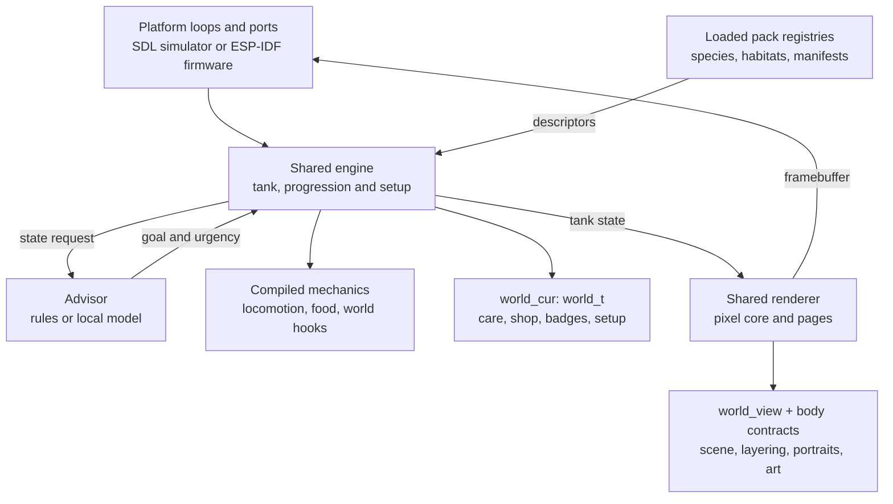
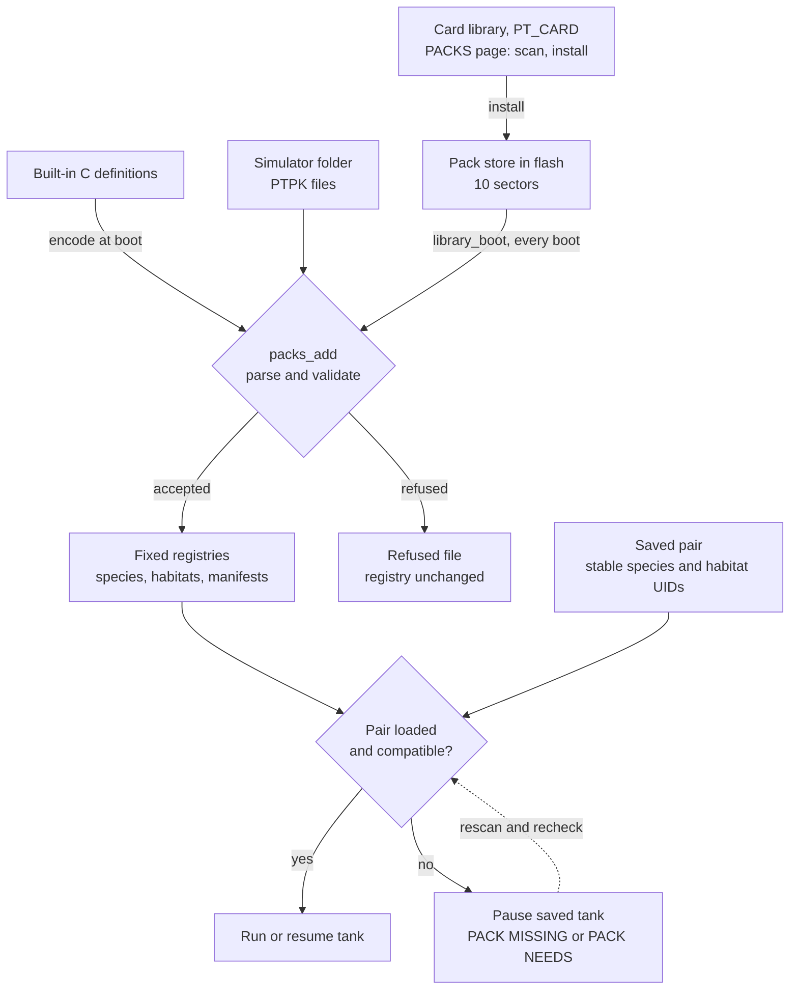

# Architecture overview

**Implemented-state snapshot:** fork `main` at `fe3ec76`, reviewed 2026-11-06. This page describes the code at that snapshot, not a promise that every proposal in the older design documents has shipped. The one change since, the **card library** ([PR #16](https://github.com/dopamine911/pocket-terrarium/pull/16), issue #4 phase 4), is described where it applies and marked *after the snapshot*; the pinned commit and its counts are unchanged. For its relationship to pocket-tank, see [Upstream divergence](upstream-divergence.md).

## The short version

Pocket-terrarium has **one reusable C11 core and two build-selected worlds**: the default terrarium and the retained aquarium. The simulator and ESP-IDF firmware share the engine, progression, rendering contracts and local-model inference code in [`common/`](../common/). Each executable currently carries **one world's code, one body family and one active model**.

The module split is implemented. Species and habitats are also implemented as validated **data packs**, with a third pack kind describing a model's goal vocabulary. Those are different extension points: a pack can tune existing behavior and geometry; it cannot install C code, invent a movement module or teach the model a new goal.

A tank holds **one species and one habitat** today. Both worlds can be built from this repository, but an executable cannot switch between them at runtime. Loading both worlds' pack descriptions in the simulator is not the same as running both worlds in one image.

## Vocabulary: six things that are not interchangeable

| Term | Meaning here | Implemented example / boundary |
|---|---|---|
| **World** | A build preset for modules, model/tokenizer, default packs, goals and keeper-facing content; also a pack-offering filter. | `terrarium` or `aquarium`, selected by [`PT_WORLD`](../common/world.h). Not a runtime enclosure instance. |
| **Tank** | One live or saved enclosure: animals, care state, a species/habitat pair and its progression. The inherited C names still include `tank_t` and `fish_t` for lizards. | Several saved terrariums in MY TERRARIUMS do not imply several worlds in one firmware. |
| **Module** | Compiled C implementation behind a contract and usually a `const` operations table. | Walk, swim, food mechanics, world rules, a scene or a body renderer. Not a downloadable plugin. |
| **Species** | A [`species_t`](../common/species.h) descriptor: locomotion, required media, diet, heat band, drive/life/shed rates, body plan and geometry, morphs/patterns, goal words and permitted habitat UIDs. | `pt.gecko.leopard`; `pt.fish.roster` represents the aquarium's fish, including their individual roster/genetic looks, not one pack per look. |
| **Habitat** | A [`habitat_t`](../common/habitat.h) descriptor: climate, areas and provisions, basking spot, hides, moisture, rocks, ramps and dish. | `pt.habitat.desert` or `pt.habitat.freshwater`. Scene drawing and mechanics remain compiled code; a habitat is not a complete executable world. |
| **Pack / model** | A **PTPK pack** is one species, habitat or model manifest. A **model** is the separate trained weight binary plus tokenizer. | `pt.model.lizard_v1.ptpk` is small metadata declaring a tag and goal words; it does **not** contain `model_q4_lizard.bin` or its tokenizer. |

A board is another independent build choice: rectangle, round pendant, watch or square. Older [board documentation](BOARDS.md#what-is-shared-and-where-a-board-may-differ) sometimes calls a board's geometry a “world”; that predates the aquarium/terrarium meaning of `PT_WORLD`.

## How the running pieces fit

The platform loops route input, time, persistence and display work into shared code. The advisor supplies a goal and urgency; the per-frame simulation performs that goal without waiting for inference. Progression handles care, growth, arrivals, milestones and saves. Rendering reads the resulting state rather than deciding behavior.

The diagram shows the principal dispatch boundaries, not every call or task:

### Responsibilities and dispatch

| Boundary | Owns | Selection and source |
|---|---|---|
| **Shared engine** | Random stream, roster/genes, animal creation/removal, time, touch/feed/light/orientation dispatch, habitat places and heat, shared upkeep and the tick. | [`tank.c`](../common/tank.c); [`progression.c`](../common/progression.c), [`setup.c`](../common/setup.c) and [`save_layout.h`](../common/save_layout.h) keep the long game and persistence shared. |
| **Locomotion** | An animal's goal-to-target behavior, steering, meals/drives, pose and movement-dependent hand/hit geometry. Walk adds ground routing, hunting and hides; swim adds swimming and depth. | [`loco_ops_t`](../common/locomotion.h), selected from the species' movement by `tank_loco(t, i)`; implementations in [`worlds/terrarium/`](../common/worlds/terrarium/) and [`worlds/aquarium/`](../common/worlds/aquarium/). |
| **Food** | What feeding drops, food motion/lifetime, sightings, counts, sleep and clearing; the terrarium module also serves its mealworm dish. | [`food_ops_t`](../common/mechanics.h), selected from the species' diet by `tank_food(t)`: pellets or crickets/mealworms. |
| **World mechanics** | Extra simulation outside the main animals' locomotion: aquarium critters; terrarium shedding, misting and decorations. | [`mech_ops_t`](../common/mechanics.h). The engine calls registered hooks at fixed points; `mech_serves` uses habitat areas where a query needs a serving module. It is not a blanket replacement for every tick hook. |
| **World behavior/content** | Rules advisor, shop effects, care gates, courtship versus hatching, badges, restoration, first-run flow and words. | [`world_t`](../common/world_ops.h), reached through `world_cur()`. The two descriptors live in [`aquarium/world.c`](../common/worlds/aquarium/world.c) and [`terrarium/world.c`](../common/worlds/terrarium/world.c). |
| **World view / scene** | Backdrop, lighting, occlusion/stacking, whole-tank painting, scene caches, tools, page art/text and body list. | [`world_view_t`](../common/world_view.h), reached through `world_view()` from [`render.c`](../common/render.c); each world's `view.c` and `scene*.c` implement it. |
| **Body** | Body-plan-specific portraits, glyphs, stage words and appearance labels on shared pages; fish or lizard drawing primitives for the scene. | [`body_ops_t`](../common/body.h), selected by the species' body plan through `body_of` / `tank_body`. The scene calls its body's drawing code directly because the scene owns placement, light and occlusion. Sources: [`bodies/fish/`](../common/bodies/fish/) and [`bodies/lizard/`](../common/bodies/lizard/). |

The movement, food and world-mechanics lists are centralized in [`locomotion/modules.c`](../common/locomotion/modules.c). They are **statically linked tables**, not registry entries loaded from a PTPK file. Today `tank_loco(t, i)` and `tank_body(t, i)` resolve the tank's one species even though their interfaces take an animal index. See [Modules](modules.md) and [World module](world-module.md) for the detailed hook maps.

## What a build actually selects

[`sim/Makefile`](../sim/Makefile) and [`firmware/components/tankcore/CMakeLists.txt`](../firmware/components/tankcore/CMakeLists.txt) select source directories, not just a default screen:

| Choice | Simulator | Firmware |
|---|---|---|
| Terrarium, the default | `make -C sim`; executable `sim/fishsim` | Kconfig `POCKET_TANK_WORLD`, default terrarium |
| Aquarium | `make -C sim WORLD=aquarium`; executable `sim/fishsim-aquarium` | Aquarium Kconfig choice / [`sdkconfig.aquarium`](../firmware/sdkconfig.aquarium) overlay |
| Board geometry | `ROUND=1`, `WATCH=1`, `SQUARE=1`, or the default rectangle | Board Kconfig choice and board-specific overlays/ports |

For the chosen world the build compiles `common/worlds/<world>/`, `common/bodies/<body>/` and `common/locomotion/`. Release firmware links only its own non-test species/habitat definitions and model manifest. Model/tokenizer paths are compile-time literals in [`world.h`](../common/world.h); model tag, length and hash constants are in [`version.h`](../common/version.h).

The simulator is deliberately broader **in data only**: `PT_ALL_PACKS=1` loads both worlds' built-in packs and both manifests, plus test-only warm gecko/desert packs. It also reports the union capability mask for boundary testing. Its Makefile still compiles only the selected world's mechanics, scene and body family, and the advisor still runs one world's model. `PT_ALL_PACKS` is therefore **not a multiworld runtime switch**.

Both `world_cur()` implementations return their own fixed descriptor; both `world_view()` implementations likewise return their own view. Goal acceptance (`GOAL_FIRST`, `GOAL_N`, `GOAL_W_*`), milestone sets and advisor token/goal mapping also retain build-selected assumptions. The “one image” sections of [Modules](modules.md#the-step-that-builds-both-worlds-into-one-image) and [World module](world-module.md#what-still-picks-a-world-at-compile-time) describe an extension direction, **not an implemented cutover**. Compiling both directories and widening a capability mask alone does not deliver runtime world/model selection.

## Species, habitats and models: who must agree?

A species states what it needs; a habitat and firmware state what they provide. The model's contribution is a **separate list of goal words**, not another bit mask. The implementation in [`packs/compat.c`](../common/packs/compat.c) requires all of these:

1. **Explicit habitat membership:** the species lists that habitat's stable UID. Registry linking derives the runtime habitat-ID mask from that list. Matching capabilities do not waive membership.
2. **Firmware capabilities:** every required movement, area, fitting and food is in `firmware_caps()`.
3. **Habitat capabilities:** the habitat provides those requirements too. `habitat_provides` combines areas, fittings/foods and the movement implied by its areas: water permits swimming; land permits walking/slithering as space, not as implemented firmware code.
4. **Active-model vocabulary:** every species goal word occurs in the manifest returned by `model_provides()`, selected by the build's `PT_MODEL_TAG`.

`species_needs` derives the bit set from **all locomotion modes and their areas + `media_needs` + diet foods**. `media_wants` describes optional use, not a hard gate. [`caps.h`](../common/packs/caps.h) defines the vocabulary and build masks; [PTPK capabilities](ptpk.md#capabilities) gives the exact refusal order and keeper-facing reasons.

Examples at this snapshot:

- **Gecko:** needs `WALK`, `LAND`, `BASK`, `HIDES`, `CRICKET`, `MEALWORM`; lists the desert. The desert supplies those through its land/basking areas, lamp, hides and food provisions. The terrarium firmware supplies the relevant mechanics, and `lizard_v1` declares `hunt bask hide explore investigate dig rest`.
- **Fish:** needs `SWIM`, `WATER`, `PELLET`; lists freshwater. The aquarium firmware and freshwater provide those, and its model manifest declares the eight fish goals.
- **Cross-world data in the simulator:** a gecko/desert pair can be present in an aquarium process, but the active fish manifest lacks `hunt`, so the pair cannot run. A release aquarium build also lacks walking; advertising or loading metadata is not installing that implementation.

The optional **`WORLDS` mask is a filter, not this compatibility gate**. `packs_offered` combines the world filter, test-only exclusion and pair compatibility for offerings. A generic pack-*selection* menu (choosing a species or habitat from what is loaded) is not implemented; having the predicate does not mean one exists. *After the snapshot:* the card library's PACKS page (see [PTPK lifecycle](#ptpk-lifecycle-and-saved-identity)) installs and removes packs from a card; it does not select them.

### Why another species need not mean another model

The lizard encoder sends normalized needs and sightings, not a species name. Heat digits 5–6 mean comfortable **relative to that species' heat band**; drive/life/shed tuning stays in the pack. The local model chooses a goal and urgency; locomotion performs it. A new species using the existing schema, body/movement implementations and supported foods can therefore be data work without retraining. A new goal such as `climb`, new perception or an unsupported body/movement behavior is not unlocked merely by writing a pack.

The active models are distinct:

| World | Schema / goals | Model file and identity |
|---|---|---|
| Terrarium | [L1](../model/schema-lizard.md): seven lizard goals, heat/shed/phase and prey/shelter sightings | `model/out/model_q4_lizard.bin`, tag `lizard_v1`; separate lizard tokenizer |
| Aquarium | [Fish schema v4](../model/schema.md): eight fish goals | `model/out/model_q4.bin`, identity tag `v3m` in the current constants; separate fish tokenizer |

The fish's schema version and model identity tag are different labels. The manifest describes the configured model's declared goal set; it neither carries weights nor switches the running brain. [`advisor_core_init`](../common/llm/advisor_core.c) identifies the schema from the tokenizer, checks required goal tokens and refuses a fish/lizard schema that disagrees with the build. The reserved manifest `INPUTS` record and runtime model switching remain future work.

## PTPK lifecycle and saved identity

[PTPK](ptpk.md) is the byte-level contract: format 1, a **20-byte header**, a length-bounded record body, UID and CRC. Records distinguish unknown **required** data (refuse the pack) from unknown optional data (skip it). This is a data-file parser, not a code/plugin loader; CRC is an integrity check, not a signature.

There are two implemented origins:

- **Built-ins:** C `const` definitions in [`species/`](../common/species/), [`habitat/`](../common/habitat/) and [`packs/models.c`](../common/packs/models.c) are the source of truth. At boot the encoder serializes them and the same `packs_add` loader validates them. The firmware ships those structs and encoder, not a second embedded set of `.ptpk` bytes.
- **Simulator folder:** [`sim/packs_dir.c`](../sim/packs_dir.c) scans `POCKET_PACKS_DIR` (default `../packs` when running from `sim/`). Manifests and habitats are offered before species. [`tools/ptpk_emit.c`](../tools/ptpk_emit.c) emits checked-in built-in files into [`packs/`](../packs/); `make -C sim packs` is also part of the normal simulator build. Independently authored TOML can be built, dumped or verified with [`tools/ptpk.py`](../tools/ptpk.py). See [Authoring](ptpk.md#authoring), rather than hand-editing binary records.
- **Card library** *(after the snapshot, PR #16; only when `PT_CARD` is 1)*: a microSD card's `/packs/NAME.ptpk` files are read one visit at a time by the PACKS page under ADVANCED, checked by [`packs_dry_check`](../common/packs/ptpk.c) (the loader's own rules with nothing committed and no pool slot taken) and, if the keeper asks, installed into a **pack store in flash** ([`pstore.c`](../common/packs/pstore.c): the `storage` partition's unused `0x6000`–`0x10000`, ten 4 KB sectors, header written last so a power cut leaves the state before or after). [`library_boot`](../common/packs/library.c) loads that store through the same `packs_add` at every boot, so a tank never depends on the card being in its slot. The simulator's card is a folder (`POCKET_CARD_DIR`) and its store a file. See [Card library](card-library.md).

The following diagram follows pack intake and **restoration of a saved tank**. A refused file leaves the loaded registry unchanged; it is different from a validly loaded pack that cannot satisfy a saved pair.

### Load-time validation versus pair-time validation

[`packs_add`](../common/packs/ptpk.c) checks the header, length and CRC, then deduplication and pool capacity **before** per-kind record parsing and semantic registry commit. With a slot available, records, values and UID are validated, followed by species/habitat/manifest rules. Unsupported movement is rejected; a species also needs at least one listed habitat loaded, and every goal must be known to some loaded model manifest. Unknown required capabilities are refused; unknown optional capabilities are dropped according to the record's rules.

A loaded species can still fail `packs_check` against a particular habitat, firmware or **active** model. `tank_set_packs` returns false with a reason instead of applying that pair. [What a loader refuses](ptpk.md#what-a-loader-refuses) describes the failure categories, but its release-image example predates zero spare slots: a new UID now encounters a full pool before semantic checks in a standard release image. Loading another model's manifest in the simulator does not make that model active.

### Identity outlives runtime handles

A pack's UID is **FNV-1a-32 of its `UID_NS`**, scoped to its kind. Dedupe compares the existing UID and body CRC: a matching offer returns `PACKS_SAME`; a different CRC under that UID is refused. These are identity/integrity checks, not cryptographic authentication. Namespaces/UIDs are durable identities, not names to recycle.

A save appends species/habitat UIDs and their saved display names to the frozen [`save_t`](../common/save_layout.h) layout. Built-ins keep legacy one-byte IDs for older saves. External species/habitats receive runtime IDs only; those handles are not saved as durable identity. Restore resolves by UID first, falling back to legacy IDs **only when the save has no UID**, not when a UID lookup fails.

### Missing or incompatible saved packs pause, not replace

[`progression.c`](../common/progression.c) preserves the saved pair and animal pack-tail state when it cannot restore that pair. The keeper sees **PACK MISSING** for unavailable data, or **PACK NEEDS** with the first unmet requirement when both packs are present but incompatible. Simulation, drives, growth, sleep advancement and glass interactions stop. Saves made while waiting keep the original identities rather than silently saving the defaults over them.

There is a rendering detail worth knowing: the build's default descriptors can stand in **only to draw the paused state**. They are not a running replacement enclosure. Progression rechecks the pair about once a second; while waiting, the simulator rescans its pack folder about every two seconds. When the required pair becomes available and compatible, restoration resumes it. The device's future microSD library is not an implemented source or hot-insertion path. Detailed behavior: [A tank and its packs](ptpk.md#a-tank-and-its-packs-the-save).

## What is implemented, and what remains a design direction

| Area | Implemented at this snapshot | Not implied / not yet implemented |
|---|---|---|
| **Terrarium** | Leopard gecko + desert, lizard body/morphs, stop-and-go ground walking, routed rocks/ramps, heat and basking, hides, cricket hunting and mealworm dish, moisture/mister, sheds and shed-gated growth, its care gates/shop/badges/setup and decorations. | Not every lizard species; walking up terrain is not an arboreal climbing/perching implementation. |
| **Aquarium** | Fish + freshwater retained on the same core, swim/depth behavior, pellet food, fish art/genetics/progression, grass/decor and aquarium critter modules. | Not a second simultaneously running world inside a terrarium binary. |
| **Packs** | PTPK encode/parse/validate, fixed registries, stable identity, needs/provides checks, model manifests, simulator folder intake and paused missing-pack restoration. *After the snapshot (PR #16, `PT_CARD`):* a card library - scan, dry check, install/update/remove into a flash pack store, a PACKS page under ADVANCED - proven in the simulator. | The 1.8's card driver is **compile-only and unverified on hardware**, and no shipped image enables it (Kconfig `CONFIG_POCKET_TANK_CARD`, default off, 1.8 only); no generic pack-selection UI or unbounded runtime registry. |
| **Models** | Separate world-selected weights/tokenizers, L1 versus fish encoding and goal checks; manifests declare supported goal names. | No hot model swapping, multiple active brains or implemented manifest `INPUTS` contract. |
| **Multiworld / mixed species** | Dispatch seams separate shared engine from world-specific code; capability vocabulary can describe water/land/shore requirements. | No one-image runtime world selection; no tank containing multiple species; no amphibious/crossover habitat shipped. |
| **Additional content** | Built-in keeper-facing species are gecko and fish; warm gecko/desert are test-only packs. | Bearded dragon, monitor, chameleon, crested gecko, jungle, reef/jellyfish and turtles are future directions, not delivered packs. `SLITHER`, `SHORE` and `GREENS` being named capabilities does not implement their missing mechanics/content. |
| **Activity / networking** | Current species validation accepts `SCHED_DAY`; the standard fork builds have networking off. | Dusk/night schedules need a clock-based day. Inherited OTA/link/passport/gift/collection designs are not enabled features of the default fork image. |

The card library is the only code on this page that postdates `fe3ec76`; the [1.8 card page](board-amoled-1.8-card.md) says what of it has run on a board (nothing). For scope and historical acceptance records, read [PLAN](../PLAN.md), especially P2e–P2g, P6 and P7, alongside the source. Its opening status and some “not committed” / future-phase wording are historical notes, not a current implementation inventory. Likewise, `DRAFT`, `DESIGN` and “nothing built” headings in older documents can coexist with later built sections. The overview above resolves those ambiguities for `fe3ec76`; it does not claim fresh hardware or test results.

### Resource constraints are part of the design

- **Flash:** the current [`partition table`](../firmware/partitions.csv) has two `0x280000` app slots and **one `0x800000` model partition** at `0x290000` in the 16 MB layout. [`version.h`](../common/version.h) records 7,558,660 bytes for the lizard model and 7,557,640 for the fish model. Both existing weight files cannot fit together in that model partition. A future one-image design needs a model strategy, not just more pack metadata.
- **RAM placement:** [`psram_plan.h`](../firmware/main/psram_plan.h) separates framebuffers and model working state/KV cache in PSRAM from internal-SRAM stacks and hot scratch; weights are memory-mapped from flash rather than copied wholesale into RAM. Wider frames, another scene/body family and spare pack slots still consume real memory. The L1 advisor reserves its 45-token prefill batch at model load to avoid later buffer growth; [PLAN P7](../PLAN.md#p7--boards) records the historical pendant measurements and remaining device checks.
- **Bounded pack storage:** [`ptpk.h`](../common/packs/ptpk.h) caps the body at 2,048 bytes, so a file is at most 2,068 bytes. Registries use fixed arrays with inline fields, no registry heap allocation and no retained pointers into input bytes. Release firmware has **zero spare species/habitat and manifest slots**; `PT_ALL_PACKS` builds add 12 spare slots for each species/habitat registry and four manifest slots. *After the snapshot:* a `PT_CARD` firmware (1.8 only, default off) has **2 species, 2 habitats and 1 manifest** spare (+2,928 B `.bss`, measured with `idf.py size` in both worlds) and the ten-sector pack store; a shipped image keeps zero, with `.bss` identical to `fe3ec76`. A parser API is device capacity for a card library only in that opt-in build.
- **Bounded behavior:** pack counts, terrain geometry and population have hard limits. Fish swimming still uses existing engine constants rather than tunable locomotion floats; nonzero SWIM/SLITHER locomotion numbers are rejected. The general-looking format is not a guarantee that every future tuning or movement is implemented.

[Memory budget](memory_budget.md) is useful for the original allocation rationale, **not an authoritative current partition table or benchmark**: its factory-app/storage layout predates the two app slots, and its latency table is an estimate. Use the current source above and the dated measurements in [PLAN](../PLAN.md) / [Stats](stats.md) for their stated worlds and hardware.

## Reading map

Start with the first group, then follow the concern you are changing. These links index the individual contracts and historical design records instead of duplicating them here.

### Core, worlds and pack contracts

| Read | Use it for |
|---|---|
| [Modules](modules.md) | Movement/food/mechanics contracts, source ownership and the proposed single-image build step. |
| [World module](world-module.md) | World descriptor fields and their engine callers. Rendering's companion contracts are [`world_view.h`](../common/world_view.h) and [`body.h`](../common/body.h). |
| [Species packs](species-pack.md) | Species fields, normalization, gecko/fish values, validation and explicit exclusions. |
| [Habitat packs](habitat-pack.md) | Climate, areas/provisions, ground coordinate/layout/routing rules, worlds and build recipes. |
| [PTPK](ptpk.md) | Exact bytes, records, identity, capability checks, refusals, registries, saves and authoring. |
| [Card library](card-library.md) | *(After the snapshot.)* The microSD card as a library of packs: verdicts, the dry check, the flash pack store and why it is not NVS, a tank on a removed pack, the PACKS page, the simulator's card. |
| [PLAN](../PLAN.md) | Fork decisions and dated implementation/acceptance history. Its [phase dependency diagram](../PLAN.md#5-phases) is the original work plan, not runtime architecture. |
| [Upstream divergence](upstream-divergence.md) | Shared baseline, fork changes and the evidence limits of the upstream-adoption comparison. |

### Simulation, care, persistence and rendering

| Read | Use it for |
|---|---|
| [Progression](progression.md), especially [the terrarium's long game](progression.md#the-terrariums-long-game-pocket-terrarium-p5---selftest-terr-progress) | Care, tended time, growth, arrivals, currency, shop, badges, light and sleep; world-specific terrarium rules. |
| [Shed](shed.md), including [the existing cycle diagram](shed.md#the-cycle) | Growth sheds, clean/stuck recovery, humid hides, mister and saved shed state. |
| [Render stack](render-stack.md) and [Swim depth](swim-depth.md) | Aquarium layer-order/occlusion matrix and depth behavior; detailed relationships belong here rather than in the overview diagram. |
| [Genetics 0.4](genetics-0.4.md) | Aquarium appearance, inherited genes, setup/birth flow and frozen animal-save implications; a historical design with built sections. |
| [Decoration shelf](decoration-shelf.md) | Ownership versus placed/shelved pieces, living decorations and save semantics; read with the implementation rather than its original “nothing built” title. |
| [Progression II](progression-next.md) | Historical reasoning about personality, goal distributions, progression and visible deliberation; not a fresh backlog. |
| [Audio](AUDIO.md) | Event-to-cue/port design, assets, battery constraints and dated acceptance notes; not a per-species sound-pack format. |

### Models, schemas and training

| Read | Use it for |
|---|---|
| [Lizard schema L1](../model/schema-lizard.md) | Encoder/tokenizer/goal contract, normalization, vocabulary and A1–A16 acceptance definitions. |
| [Fish schemas](../model/schema.md) | Frozen fish input/output contracts and v2/v3/v4 evolution. |
| [Training pipeline](pipeline.md), including [the training harness](pipeline.md#training-harness) | Teacher traces through folding, training, export and selection; shared tooling rather than one current-world recipe. |
| [Lizard retraining](retrain-lizard.md) | Actual L1 teacher/prompt work, focused repair, selection and sim-census record. |
| [v3 retraining](retrain-v3.md), [v4 retraining](retrain-v4.md), [queued retraining](retrain-next.md) | Aquarium training history and proposed future schema changes; read dates and outcome sections. |
| [Stats](stats.md) | Dated measured model, tokenizer, latency and generation results; not universal hardware guarantees. |

### Platforms, device limits and inherited optional systems

| Read | Use it for |
|---|---|
| [Simulator quick start](../README.md#run-the-simulator-in-docker-linux-desktop) and [per-world builds](habitat-pack.md#building-each-world) | Running the fork's world/board choices without confusing pack inventory with executable selection. |
| [Boards](BOARDS.md) | Shared-code/coordinate/port rules and the four board targets. |
| [1.8 card slot](board-amoled-1.8-card.md) | *(After the snapshot.)* The 1.8's microSD driver: each pin with its source, what is unverified, measured size costs and a bench test. |
| [Round pendant](board-amoled-1.75c.md), [watch](board-amoled-2.06-watch.md), [square](board-amoled-2.16.md) | Board-specific display, touch, pins, power and bring-up findings. |
| [Bring-up](bringup.md) and [Device](DEVICE.md) | Original 1.8 checklist and safe device/preflight practices; device status notes are dated. |
| [Memory budget](memory_budget.md), [`psram_plan.h`](../firmware/main/psram_plan.h), [`partitions.csv`](../firmware/partitions.csv) | Allocation rationale versus current compile-time memory/flash limits; heed the stale-layout caveat above. |
| [OTA](OTA.md) and [browser installer](../installer/README.md) | Inherited update/partition/install design and historical status; not evidence that networking is enabled in the default fork build. |
| [Tank link 0.4](tank-link-0.4.md) | Inherited peer/lease/passport/visit/gift protocol and implementation notes, behind the fork's networking build boundary. |

The original [three-layer explanation](../README.md#how-its-put-together) remains useful background. The two diagrams here cover the new module and pack boundaries; the linked phase and shed diagrams retain their more specific roles.
