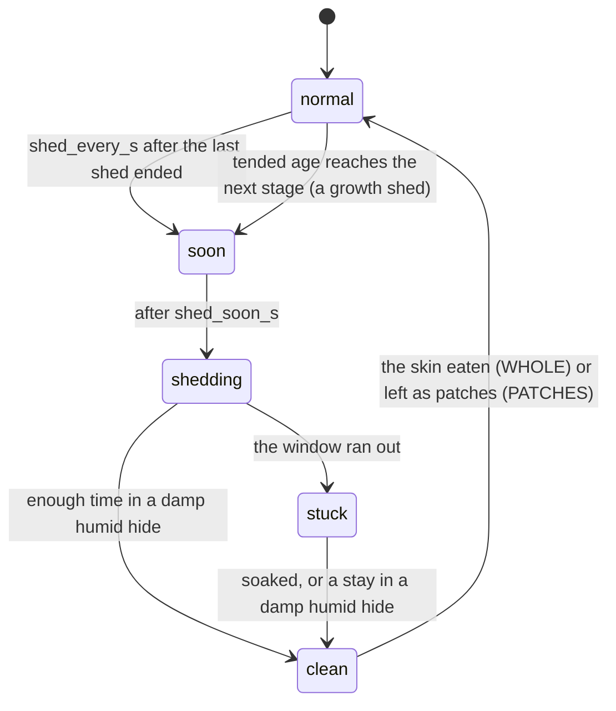

# Shed — DRAFT

Lizards grow by shedding their skin. In pocket-terrarium the shed is an upkeep
loop like wiping the glass and trimming the plants: it comes round on a timer,
the lizard shows it is coming, and the keeper's part is keeping the humid hide
damp. Done well, the shed comes off clean and the lizard grows. Neglected, it
sticks, and the lizard is uncomfortable until it is helped.

Timings come from the species pack (`docs/species-pack.md`); the numbers below
are the leopard gecko's. All times are tended time (the progression clock):
awake time counts in full, sleep at a quarter (`SLEEP_GROWTH_FRAC`, `progression.h:87`).

## The cycle

| State | Model sees | Lasts | What the keeper sees |
|---|---|---|---|
| normal | `shed no` | `shed_every_s[stage]` (gecko 900 / 1,800 / 10,800 / 21,600 s), or until the next stage's age | — |
| soon | `shed soon` | `shed_soon_s` (300 s) | skin paling, eyes dull blue-grey, eats less |
| shedding | `shed yes` | up to `shed_window_s` (600 s) | skin loosening from the nose back |
| stuck | `shed yes` | until helped | white rings left on toes and tail tip |
| clean | `shed no` | a moment | the old skin off in one piece; the gecko eats it |

`soon` and `shedding` raise hunger more slowly (× 0.5, awake: it is the appetite; the sleep's own rate is
unchanged) and make strikes less likely to be attempted, as real pre-shed lizards go off their food. The model
also reads `shed soon|yes` and leans toward `hide` (schema rule 3).

## Growing up: a shed comes first

A lizard never changes stage without shedding. When its tended age reaches the
next stage (`stage_s` in its pack), a **growth shed** starts at once: `soon`
begins that moment, whatever the shed timer says. The stage changes the moment
that shed comes off clean, and the new stage's markings show on the fresh skin
(the gecko's hatchling bands breaking into adult spots).

- Already in a shed cycle when the age is reached (`soon`, `shedding` or `stuck`):
  that shed is the growth shed; no second one starts.
- A stuck growth shed holds the stage back until it is cleared (below).
- Any shed, growth or timed, restarts the `shed_every_s` timer when it ends.
- Asleep: the age and the shed run at the sleep rate as usual; a growth shed
  that falls in the night is in progress (or done) in the morning, like a fry
  arriving overnight in the fish tank.

Gecko timeline, awake: a hatchling's first timed shed starts at 15 min (`soon`
15–20 min, `shedding` from 20 min). It is still under way when the juvenile age
arrives at 20 min, so it becomes the growth shed: a juvenile at about 21 min with
a damp humid hide it uses, later if it dawdles, and not at all while the shed is stuck.

## Coming off clean

A shed comes off clean when, during `shedding`, the lizard spends
**`SHED_SOAK_S` = 60 s in total** inside a humid hide whose **moisture is at
least `SHED_DAMP` = 0.35**. Time inside counts while it is damp enough; it does
not have to be one stay. A dry humid hide does nothing. Inside means gone in
(P2b, `tank.h` THE WALK: `fish_t.hide`, hidden or peeking out) - a lizard
walking past the hide's mouth is not in it.

A lizard with `shed yes` that the model sends to `hide` goes to the humid hide
(`model/schema-lizard.md`, goal `hide`), so a well-kept terrarium sheds clean
without the keeper doing anything at the moment of the shed. The work is the
upkeep before it.

## Stuck shed

If the window ends without enough damp time, the shed sticks:
- `stress` is pushed up `STUCK_STRESS_PER_S` = 0.005 /s (about +18 an hour) while it lasts, but never past 6
  by this alone: uncomfortable, not panicked. As built (P2a): the reflex's stress settles by itself at ~0.18 a
  second, so a plain +0.005 /s would never show; the push is a **floor** under the stress that rises 0.005 a
  tended second stuck, to 6 (6 after 20 stuck minutes awake), and goes with the shed.
- The model keeps seeing `shed yes`, so the lizard keeps seeking the humid hide.
- Growth: a stuck growth shed holds the stage back until it comes off (above).

Two ways off:
1. **A stay in a damp humid hide**: another `SHED_SOAK_S` of damp time clears it.
2. **A soak**: with the mister in hand, hold on the lizard for `SOAK_HOLD_S` = 3 s.
   It clears at once, costs the lizard a little stress (+1) and, on a trusting
   lizard (trust ≥ 6), earns a little trust (+0.2): being helped by a hand it knows.

## Moisture

Each humid hide has `moisture` 0..1, saved with the terrarium.
- Dries at `MOIST_DRY_PER_S` = 1/10,800 awake (full to dry in ~3 h), a quarter of that asleep: a tended
  second, the shed's own clock. As built (P2a) the rate and the start are the habitat's (`common/habitat.h`
  `moist_dry_per_s`, `moist_start`; the desert's are these).
- Each mister pass over the hide adds `MIST_PASS` = 0.35, up to 1.
- Shown on the hide: the substrate at its mouth darkens with moisture; at 0 it looks pale and dusty.
- A fresh terrarium starts at 0.6.

## The mister (a third tool)

The tool row under a lizard's card gains a third tool next to the sponge and
the scissors: `TOOL_MISTER`. The rules are the existing tools' (`tank.h:1148`):
picked from the card, a DONE chip top left, back in the box after `TOOL_IDLE_S`
(120 s), and while it is in hand the glass takes its strokes and nothing else.

| Gesture with the mister | Effect |
|---|---|
| a stroke or tap over a humid hide | +`MIST_PASS` moisture (once per stroke), a spray drawn |
| a stroke over the open terrarium | a spray drawn, nothing else (a fine mist settles and dries) |
| hold on a lizard 3 s | stuck shed: the soak. Otherwise: sprayed, stress +1 (they dislike it) |

The tool hit test today splits the row in halves (`render.c:7553`); with three
tools it splits in thirds.

## Milestones

As built (P5, `docs/progression.md` "The terrarium's long game", `--selftest-terr-progress`):

| Badge | Earned |
|---|---|
| FIRST CLEAN SHED (a lizard's, MS_FIRST_SHED) | its first shed off clean without sticking |
| FIRST STUCK SHED FIXED (TMS_SHED_HELPED) | a stuck shed cleared - by the mister's soak or a damp stay |
| THREE CLEAN SHEDS IN A ROW (TMS_CLEAN_RUN) | CLEAN_RUN_N (3) sheds in a row off clean, tank-wide; a shed sticking breaks the row |
| FIRST ADULT (TMS_FIRST_ADULT) | a lizard grown to adult, at its clean growth shed |

Later (not built, no badge): FIRST MIST, the keeper's first mister pass. The hatchling's gates count the lizards' clean
sheds too (4 for the first).

## Saved

Per lizard: shed state, seconds left in it, damp seconds accrued, whether it is a growth shed, clean-shed count. Per
terrarium: each humid hide's moisture, the clean-run counter. P2a writes all of it but the clean-run counter in the
save's packs tail (`progression.c`, SAVE LAYOUT LOCK: 1956..2095; P2c appended the mealworm dish at 2096), with the
species' and the habitat's ids and each lizard's body temperature; P5 appended the clean run at 2097 (and the mealworm
farm's dish at 2098).

## Sand dollars (P2c)

A shed that comes off clean and never stuck pays `SD_SHED_CLEAN` (5); one cleared after it stuck (a damp stay or a
soak) is counted clean and pays nothing (`fish_t.shed_helped`); a growth shed adds its stage's pay
(`docs/progression.md` "Sand dollars", `--selftest-terr-pay`).

## Tests (P2)

Through the sim, never by reading constants:
- reaching a stage's age starts a growth shed at once, even with the shed timer far off, and the stage
  changes only when that shed comes off clean - never at the age itself;
- the age reached mid-cycle: that shed is the growth shed, no second one starts;
- a dry hide: the growth shed sticks, stress rises toward 6, the stage holds until it is cleared;
- a stuck shed cleared both ways (a damp stay, a soak);
- moisture falls over three awake hours to 0 and four times slower asleep;
- a sleep across a whole shed cycle (the timers run at the sleep rate and the state is right on waking).
